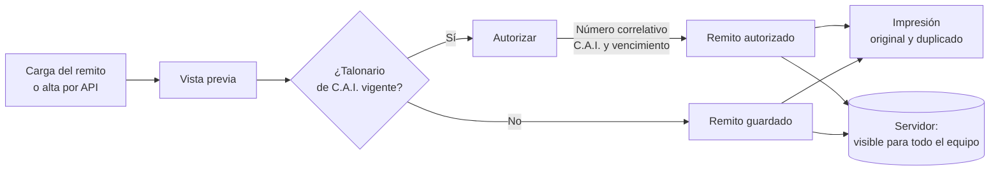

<p align="center">
  
</p>

<p align="center">
  
  
  
  
  
  
</p>

<p align="center">
  <b><a href="https://intellihelp.tech/remitos">intellihelp.tech/remitos</a></b>
</p>

---

## Descripción

**Remitos y Comprobantes de Intellihelp**: aplicación interna para emitir **remitos**, **facturas**, **recibos** y **notas de crédito y débito** con el diseño del talonario de la empresa, imprimirlos y guardarlos en PDF.

- El **remito** se imprime **sobre el talonario pre-impreso**, con cada dato calibrado al milímetro, o como **documento completo** en papel en blanco o PDF, con original y duplicado.
- Se **autoriza** con el **C.A.I.** del talonario vigente: número correlativo, código y vencimiento se asignan solos.
- Las **facturas, recibos y notas** toman su numeración de **ARCA** (último autorizado + 1) a través de los web services.
- **Datos compartidos**: clientes, remitos, comprobantes y ajustes viven en el servidor; todo el equipo trabaja sobre la misma información, con **usuarios y roles**.
- Si se corta la conexión, el documento en curso se sigue guardando en el equipo y se sube solo al volver la red.
- Otros sistemas pueden **crear remitos por API** y recibir un enlace que los abre listos para imprimir.

## Índice

- [Capturas](#capturas)
- [Funcionalidades](#funcionalidades)
- [Circuito de un remito](#circuito-de-un-remito)
- [Integración con ARCA](#integración-con-arca)
- [Arquitectura](#arquitectura)
- [Seguridad](#seguridad)
- [Instalación y despliegue](#instalación-y-despliegue)
- [Pruebas](#pruebas)
- [Autor](#autor)

## Capturas

> Las capturas usan datos ficticios de demostración.

### Ingreso

<p align="center"></p>

### Inicio

Accesos rápidos, totales y documentos recientes con su estado (autorizado, guardado o borrador sin guardar) y quién los modificó por última vez.

<p align="center"></p>

### Remito

El formulario se completa a la izquierda y la vista previa se actualiza en el acto. El modo **sobre pre-impreso** muestra el talonario como guía tenue e imprime solo los datos; el **documento completo** genera el remito entero con el sello de autorizado.

<p align="center"></p>

<table>
  <tr>
    <td width="50%"><b>Sobre el talonario pre-impreso</b><br></td>
    <td width="50%"><b>Calibración por impresora</b><br></td>
  </tr>
  <tr>
    <td width="50%"><b>Ajuste fino de cada campo</b><br></td>
    <td width="50%"><b>Agenda de clientes</b><br></td>
  </tr>
</table>

### Facturas, recibos y notas

Diseño tomado de los comprobantes que emite ARCA: banda de ejemplar, letra y código, emisor, receptor, detalle, totales con IVA discriminado en la letra A y pie con CAE. Sin CAE, el documento se imprime marcado como borrador.

<table>
  <tr>
    <td width="50%"><b>Factura A</b><br></td>
    <td width="50%"><b>Recibo con importe en letras</b><br></td>
  </tr>
</table>

### Conexión con ARCA

El certificado y la clave privada se cargan una vez por ambiente. El servidor valida que se correspondan y los guarda cifrados; la pantalla solo muestra titular, CUIT, vigencia y huella.

<table>
  <tr>
    <td width="50%"><b>Datos del emisor y certificado</b><br></td>
    <td width="50%"><b>Carga segura del certificado</b><br></td>
  </tr>
</table>

### Usuarios

<table>
  <tr>
    <td width="50%"><b>Usuarios y roles</b><br></td>
    <td width="50%"><b>Alta con contraseña temporal</b><br></td>
  </tr>
</table>

### Panel de la API

<table>
  <tr>
    <td width="50%"><b>Talonarios de C.A.I.</b><br></td>
    <td width="50%"><b>Claves de servicio</b><br></td>
  </tr>
  <tr>
    <td width="50%"><b>Estado de los documentos</b><br></td>
    <td width="50%"><b>Auditoría</b><br></td>
  </tr>
</table>

### Celular

<p align="center">
  
  &nbsp;
  
  &nbsp;
  
</p>

## Funcionalidades

### Remitos
- Remito clase **R**, código **091**, con la leyenda «Documento no válido como factura» y los datos de autoimpresor del emisor.
- Dos modos de impresión con **calibraciones independientes**: sobre el talonario pre-impreso (24 ajustes de fábrica medidos sobre impresiones reales) y documento completo.
- Ejemplares **original y duplicado** (RG 1415, art. 14); el duplicado se imprime en beige, como el talonario.
- **Autorización** con el C.A.I.: número correlativo dentro del rango, código y vencimiento; bloqueo si el C.A.I. está vencido y avisos por pocos números o vencimiento próximo.
- Fecha automática en hora de Buenos Aires tomada del reloj del servidor; editable.
- Impresión de prueba con datos ficticios, hoja con grilla en milímetros y prueba de posiciones para calibrar.

### Facturas, recibos y notas de crédito y débito
- Letras A, B, C y X con el código oficial de cada comprobante.
- Ítems, alícuota de IVA, condición frente al IVA del receptor, comprobante asociado en las notas e importe en letras en el recibo.
- Numeración correlativa local o, con la emisión electrónica activa, **según ARCA**.
- CAE y vencimiento por comprobante.

### Datos y operación
- **Agenda de clientes compartida** con búsqueda e importación desde **CSV o Excel** (detección de encabezados en español, con o sin acentos; actualiza por CUIT sin duplicar).
- **Numeración asignada por el servidor**: dos personas guardando a la vez nunca reciben el mismo número.
- **Copia de seguridad** completa en un archivo, con validación al importar.
- **Borrador protegido**: el documento en curso se guarda en el equipo mientras se escribe; ante un corte, queda pendiente y se sube solo al volver la red.
- Atajos **Ctrl+S** y **Ctrl+P** según el documento en pantalla.

### Usuarios y acceso
- Ingreso con **correo y contraseña**; contraseña temporal en el alta, con cambio obligatorio en el primer ingreso.
- Roles **operador** (documentos y clientes) y **administrador** (además usuarios, ajustes, certificado de ARCA, talonarios y panel).
- «Mi cuenta» para cambiar la contraseña; el administrador genera contraseñas temporales y activa o desactiva usuarios.
- La calibración de impresión queda en cada equipo, porque depende de su impresora.

### Panel de la API
- Estado de los remitos y pendientes de facturar.
- **Talonarios de C.A.I.**: alta con validación de rango y superposición, semáforo de vencimiento y uso.
- **Claves de servicio** con permisos `leer`, `crear` y `borrar`, contador de uso y revocación inmediata.
- **Auditoría** por categoría, paginada, con origen (aplicación o API), clave e IP.

## Circuito de un remito



| Estado | Significado |
|---|---|
| Borrador | En edición; se guarda en el equipo de quien lo carga y se recupera tras un corte |
| Guardado | Guardado con número correlativo |
| Autorizado | Con número del talonario, C.A.I. y vencimiento; lleva el sello AUTORIZADO |

## Integración con ARCA

| Servicio | Uso |
|---|---|
| **WSAA** | Autenticación: el servidor firma el pedido de acceso (CMS/PKCS#7) con el certificado y guarda el ticket mientras está vigente (hasta 12 horas) |
| **WSFEv1 · FEDummy** | Verificación del estado de los servidores de ARCA |
| **WSFEv1 · FECompUltimoAutorizado** | Último número autorizado por punto de venta y tipo, para proponer el siguiente |
| **C.A.I.** | ARCA no ofrece web service: se tramita con Clave Fiscal y se carga en el panel una vez por rango |

Ambientes de **homologación** y **producción**, cada uno con su propio certificado. El instructivo paso a paso para obtener el certificado está en [`app/docs/guia-credenciales-arca.pdf`](app/docs/guia-credenciales-arca.pdf) y la referencia de la API en [`docs/api.md`](docs/api.md).

## Arquitectura

Aplicación de **una sola página** en HTML, CSS y JavaScript sin dependencias, con una **API en PHP 8 sin framework** sobre MySQL/MariaDB, pensada para hosting compartido.

```
├── app/                     # Se publica tal cual en public_html/remitos
│   ├── index.html           # Aplicación
│   ├── panel.html           # Panel de administración de la API
│   ├── css/                 # Estilos de la aplicación y del panel
│   ├── js/
│   │   ├── config.js        # Papel, posición de cada campo, calibración de fábrica, datos del emisor
│   │   ├── app.js           # Edición, vista previa, impresión, agenda y configuración
│   │   ├── servidor.js      # API, sesión, ingreso, usuarios y datos compartidos
│   │   └── panel.js         # Panel de la API
│   ├── api/
│   │   ├── bootstrap.php    # Arranque común y manejo de errores
│   │   ├── lib/             # http · db (migraciones) · session · users · auth · audit · crypto · arca
│   │   ├── sesion.php       # Ingreso, salida y cambio de contraseña
│   │   ├── usuarios.php     # Administración de usuarios
│   │   ├── clientes.php     # Agenda de clientes
│   │   ├── remitos.php      # Remitos (numeración asignada por el servidor)
│   │   ├── comprobantes.php # Facturas, recibos y notas
│   │   ├── ajustes.php      # Datos del emisor y punto de venta
│   │   ├── talonarios.php   # C.A.I. y autorización de remitos
│   │   ├── arca.php         # Credenciales y conexión con ARCA
│   │   ├── proximo.php      # Próximo número según ARCA
│   │   ├── estado.php       # Seguimiento sin datos confidenciales
│   │   ├── claves.php       # Claves de servicio y auditoría
│   │   ├── evento.php       # Eventos de la aplicación
│   │   ├── cli/usuario.php  # Alta de usuarios por línea de comandos
│   │   └── config.sample.php
│   ├── docs/                # Instructivo de alta en ARCA (HTML y PDF)
│   └── assets/              # Logos
├── docs/                    # Banner, capturas y referencia de la API
├── test/                    # Pruebas automatizadas (Playwright)
└── tools/                   # Generación del instructivo en PDF
```

| Capa | Tecnología |
|---|---|
| Interfaz | HTML + CSS propio + JavaScript sin dependencias; SheetJS se carga solo al importar Excel |
| Datos | En el servidor; en el equipo solo la calibración de la impresora y el borrador en curso |
| Servidor | PHP 8.2+ (PDO, OpenSSL, cURL, DOM) |
| Base de datos | MariaDB 10.6+ / MySQL 8, esquema versionado con migraciones idempotentes |
| Integraciones | ARCA WSAA y WSFEv1 (SOAP) |
| Calidad | PSR-12 (PHP-CS-Fixer), Prettier, 84 casos de prueba automatizados |
| Identidad | Tipografía Saira · paleta `#663399` · `#9f88b1` · `#fff6ff` · `#fffade` · colores planos |

## Seguridad

**Usuarios y sesión**
- Contraseñas con `password_hash` (bcrypt) y política de complejidad; contraseña temporal con cambio obligatorio.
- Cookie de sesión `HttpOnly`, `Secure` y `SameSite=Strict`, limitada a la ruta de la aplicación; identificador regenerado al ingresar y al cambiar la contraseña.
- **Token CSRF** obligatorio en toda escritura; vencimiento por inactividad (8 h) y absoluto (12 h).
- **Bloqueo de la cuenta** tras 5 intentos fallidos y límite de ingresos fallidos por IP; el mensaje de error no revela si el correo existe y el tiempo de respuesta es el mismo.
- El usuario se relee en cada petición: desactivarlo o cambiarle el rol rige en el acto. Siempre queda al menos un administrador.

**Credenciales de ARCA**
- El certificado y la clave privada **nunca se guardan en el navegador**: los carga un administrador, que reconfirma su contraseña, y se envían una sola vez al servidor por **HTTPS obligatorio**.
- El servidor valida que sean PEM correctos, que la clave (RSA de 2048 bits o más) corresponda al certificado, que esté vigente y que el CUIT coincida.
- Se almacenan **cifrados con AES-256-GCM**. La clave de cifrado vive solo en `config.php` (fuera del repositorio y de la base) y se deriva una subclave por propósito con **HKDF-SHA256**. Cada valor queda ligado a su ambiente y su campo como dato autenticado: un valor copiado a otra fila no se descifra.
- Los tickets de WSAA también se guardan cifrados. La firma se hace en el servidor: los archivos temporales solo contienen el pedido y la firma, con permisos `0600`, y se eliminan siempre.
- Las respuestas de la API nunca incluyen el certificado ni la clave: solo titular, CUIT, vigencia y huella SHA-256.

**API**
- Claves con prefijo `ith_` y 128 bits de entropía. De la maestra y de las de servicio se guarda solo el **SHA-256**; la comparación es en tiempo constante.
- Permisos mínimos por clave, revocación inmediata y **bloqueo temporal** por IP tras 20 intentos rechazados en 10 minutos.
- Consultas **parametrizadas** (PDO sin emulación), validación y recorte de todos los datos de entrada y límite de tamaño de 256 KB por petición.
- Errores internos registrados solo en el log del servidor; el cliente recibe un mensaje genérico.
- `config.php`, `bootstrap.php` y `lib/` bloqueados para la web; la clave nunca viaja en la URL.
- **Auditoría** de los eventos relevantes, incluidos los accesos rechazados.

**Aplicación**
- **Content-Security-Policy** sin scripts inline ni de terceros, `X-Frame-Options: DENY`, `nosniff`, `Referrer-Policy`, `Permissions-Policy`, HSTS y redirección a HTTPS.
- Escape de todo dato mostrado en pantalla.
- El panel de la API se abre con la sesión de un administrador; una clave de API solo se conserva mientras la pestaña está abierta (`sessionStorage`).

## Instalación y despliegue

### Requisitos
- PHP 8.2+ con `pdo_mysql`, `openssl`, `curl`, `dom` y `mbstring`
- MariaDB 10.6+ o MySQL 8
- Servidor web Apache o LiteSpeed con `.htaccess` habilitado

### Pasos

```bash
# 1. Publicar el contenido de app/ en public_html/remitos/

# 2. Configuración de la API
cp app/api/config.sample.php app/api/config.php
#    completar la base de datos y generar las claves:
php -r "echo bin2hex(random_bytes(32)), PHP_EOL;"                                   # app_key
php -r "\$k='ith_'.bin2hex(random_bytes(24)); echo \$k, PHP_EOL, hash('sha256',\$k), PHP_EOL;"   # clave maestra y su hash

# 3. Primer administrador (las tablas se crean y migran solas):
php app/api/cli/usuario.php "Nombre Apellido" correo@intellihelp.tech admin
#    imprime una contraseña temporal que se cambia en el primer ingreso
```

Después:
1. Ingresar a la aplicación con el administrador y crear los usuarios del equipo en **Configuración → Usuarios**.
2. En **Configuración → Conexión con ARCA**: CUIT, puntos de venta y el certificado.
3. Cargar el talonario de C.A.I. desde el **Panel de la API** según el instructivo.

Los recursos se referencian con `?v=NNN`: al publicar cambios en CSS o JS se incrementa la versión en `index.html` y `panel.html`.

## Pruebas

```bash
pip install playwright pymupdf cryptography && playwright install chromium
python test/correr.py
```

**84 casos** automatizados sobre la aplicación en el navegador y la API: impresión y ejemplares, formularios y formatos, documentos PDF, inicio y recuperación de borradores, C.A.I., usuarios, sesión y roles, datos compartidos, numeración concurrente, autenticación y permisos, credenciales de ARCA (incluida la firma real contra WSAA de homologación) y validación de datos. Por defecto corren contra un entorno local (`php -S` y una base de pruebas); ver [`test/LEEME.md`](test/LEEME.md).

## Autor

**Brian Gabriel Sierra**
Jefe de Sistemas e Infraestructura IT — Intellihelp

[](https://www.linkedin.com/in/brian-gabriel-sierra)

---

<p align="center">
  <sub>© 2026 Intellihelp · Software de uso interno. Todos los derechos reservados.</sub>
</p>
