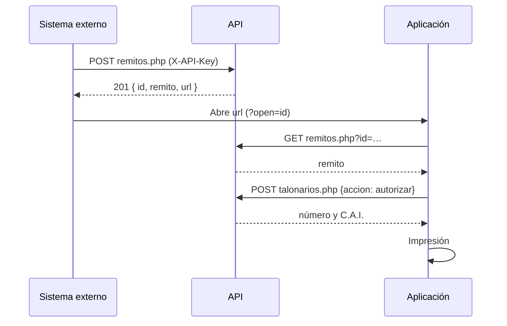

# API de Remitos y Comprobantes

API REST/JSON de la aplicación: usuarios y sesión, clientes, remitos y comprobantes compartidos, emisión electrónica con CAE, ajustes, talonarios de C.A.I., claves de acceso, auditoría y credenciales de ARCA. La usa la propia aplicación (con la sesión del usuario) y otros sistemas (con una clave de API).

| | |
|---|---|
| **URL base** | `https://intellihelp.tech/remitos/api/` |
| **Formato** | JSON (UTF-8). Toda escritura se envía con `Content-Type: application/json` |
| **Autenticación** | Sesión de usuario (aplicación) o cabecera `X-API-Key` (integraciones) |
| **Errores** | `{ "ok": false, "error": "mensaje" }` con el código HTTP correspondiente |

## Autenticación

### Sesión de usuario (la aplicación)

La aplicación se ingresa **solo con la cuenta de Google** de Intellihelp (`google.php`); no hay contraseñas ni segundo factor propios. El ingreso deja una cookie de sesión `HttpOnly`, `Secure` y `SameSite=Strict`, más un token CSRF que debe enviarse en la cabecera `X-CSRF-Token` en toda escritura. Las escrituras con sesión solo se aceptan como `application/json` y, si el navegador informa el origen (`Origin`), desde el propio sitio. Los permisos dependen del rol:

| Rol | Permisos |
|---|---|
| Operador | `leer`, `crear`, `borrar`: clientes, remitos, comprobantes, autorización de remitos y emisión con CAE |
| Administrador | Lo anterior más `admin`: usuarios, ajustes, certificados de ARCA, talonarios, claves, auditoría y exportación |

- La sesión vence tras 8 horas sin actividad o 12 horas desde el ingreso.
- Cambiar el rol o desactivar al usuario cierra todas sus sesiones.
- **Freno de ingresos fallidos** (ventana de 15 minutos): 5 por correo desde la misma conexión, 30 por conexión y 50 por correo en total. El freno responde `429` con el mismo mensaje exista o no el correo, y no bloquea la cuenta para los demás.
- **Ingreso con Google** (`google` en `config.php`; sin esa configuración nadie puede ingresar a la aplicación): `GET google.php?accion=inicio` lleva a Google (OpenID Connect con PKCE, limitado al dominio de Google Workspace configurado) y la vuelta abre la sesión si el correo es de un usuario activo. El estado viaja cifrado en una cookie `SameSite=Lax` de 10 minutos; un error vuelve a la aplicación con `?ingreso=<código>` (`google_sin_usuario`, `google_dominio`, `google_vencido`, `google_cancelado`, `google_error`, `google_limitado`). La seguridad de la cuenta (contraseña, verificación en dos pasos) la administra Google Workspace.
- **Confirmación de identidad** (cargar o quitar el certificado de ARCA): la sesión informa `confirmado` (ingreso con Google de los últimos 15 minutos). Pasado ese plazo la operación responde `403` con `reconfirmar_google: true`, y `GET google.php?accion=inicio&confirmar=1` vuelve a pasar por Google con la cuenta de la sesión y regresa con `?ingreso=confirmado`.

### Clave de API (integraciones)

Cada petición lleva la clave en la cabecera `X-API-Key`. La clave nunca viaja en la URL.

```
X-API-Key: ith_0123456789abcdef0123456789abcdef
```

| Clave | Dónde se define | Alcance |
|---|---|---|
| **Maestra** | `api/config.php` (se guarda solo su SHA-256) | Todo, igual que un administrador |
| **De servicio** | Panel → Claves | Permisos acotados: `leer`, `crear`, `borrar`. Se guarda solo su SHA-256 y se muestra una única vez |

Una conexión que acumula 20 claves rechazadas en 10 minutos queda frenada temporalmente (`429`). Los intentos fallidos se cuentan en una tabla propia, separada de la auditoría.

### CORS

La aplicación llama a la API desde su mismo origen. CORS solo se habilita para los orígenes listados en `allowed_origins` (`config.php`); las integraciones de servidor a servidor no lo necesitan.

## Flujo típico de integración



## Sesión y usuarios

| Método | Operación | Acceso |
|---|---|---|
| `GET sesion.php` | Usuario de la sesión y token CSRF. Sin sesión: `usuario: null` (y `segundo_factor: true` si falta el código) | público |
| `POST sesion.php` `{accion: "salir"}` | Cierra la sesión | sesión |
| `GET usuarios.php` | Lista de usuarios (con `segundo_factor` y `bloqueado`) | admin |
| `GET google.php?accion=inicio` | Ingreso con Google (redirige a Google y vuelve a la aplicación) | público |
| `GET google.php?accion=inicio&confirmar=1` | Vuelve a confirmar la identidad con la cuenta de la sesión | sesión |
| `POST usuarios.php` `{nombre, email, rol}` | Alta (el correo tiene que ser del dominio de Google configurado); desde ese momento ingresa con Google | admin |
| `POST usuarios.php` `{accion: "editar", id, nombre?, rol?, activo?}` | Edición y activación | admin |
| `DELETE usuarios.php?id={id}` | Baja | admin |


Siempre queda al menos un administrador activo, y nadie puede quitarse el rol, desactivarse ni eliminarse a sí mismo. Por línea de comandos:

```bash
php api/cli/usuario.php "Nombre Apellido" correo@dominio admin   # alta
php api/cli/usuario.php admin correo@dominio                     # recuperar el acceso: lo activa como administrador
```

## Clientes

| Método | Operación | Permiso |
|---|---|---|
| `GET clientes.php?buscar=` | Agenda por razón social, hasta 5000 por respuesta. `total` es el total real y `completo` indica si entró toda | `leer` |
| `POST clientes.php` `{id?, razonSocial, cuit, condIVA, …}` | Alta o edición. El CUIT se valida con su dígito verificador (también se acepta un DNI de 7 u 8 dígitos), se normaliza y no se repite | `crear` |
| `POST clientes.php` `{accion: "importar", clientes: […]}` | Alta o actualización por CUIT, hasta 2000 por vez; los campos vacíos no borran datos y las filas con CUIT inválido se informan en `cuit_invalidos` sin cargarse | `crear` |
| `DELETE clientes.php?id={id}` | Baja | `borrar` |

## Remitos

### Numeración

El número fiscal de un remito (punto de venta y correlativo, `00001-00000012`), el C.A.I. y su vencimiento los asigna **únicamente la autorización** contra un talonario (`talonarios.php`), y la base impide que se repitan (clave única por punto de venta y número). Hasta entonces el remito es un **borrador** con una referencia interna (`"referencia": 12`) que no se confunde con un número fiscal y se imprime con el sello «SIN AUTORIZAR». Lo que el cliente envíe en `numero`, `cai` o `caiVto` se ignora.

Un remito autorizado no se modifica ni se elimina; solo admite la marca de facturado.

**Contenido obligatorio (RG 1415, Anexo V).** Cada borrador devuelve `faltantes`, la lista de lo que le falta para poder autorizarse: condición del destinatario frente al IVA (`cliente.condIVA`), su CUIT y domicilio salvo que sea consumidor final, descripción y cantidad de los bienes, y el tipo de traslado (`transporte.tipo`: `propio` o `tercero`; con un tercero, `transporte.nombre`, `transporte.cuit` y `transporte.domicilio`). Ver [`normativa.md`](normativa.md).

### `POST remitos.php` — crear o editar un borrador · permiso `crear`

```json
{
  "id_local": "erp-000123",
  "fecha": "21/10/2026",
  "cliente": {
    "razonSocial": "DISTRIBUIDORA EJEMPLO S.A.",
    "cuit": "30-50001091-2",
    "condIVA": "Responsable Inscripto",
    "domicilio": "Av. Corrientes 1234",
    "localidad": "CABA",
    "cp": "C1043",
    "mail": "compras@ejemplo.com.ar"
  },
  "items": [
    { "articulo": "1", "descripcion": "Servicio técnico en sitio", "cantidad": "2 hs" }
  ],
  "recibi": { "tipoDoc": "DNI", "nombre": "María Gómez", "documentoNro": "30.123.456" },
  "transporte": {
    "tipo": "tercero", "nombre": "Transportes Ejemplo", "cuit": "20-12345678-6", "domicilio": "Ruta 3 km 40",
    "hora": "14:30", "observaciones": "Entregar en recepción"
  }
}
```

Respuesta `201`:

```json
{
  "ok": true,
  "id": "9f2c1a77bd0e4a13",
  "actualizado": false,
  "remito": { "id": "9f2c1a77bd0e4a13", "estado": "borrador", "referencia": 12, "numero": "", "cai": "", "…": "…" },
  "url": "https://intellihelp.tech/remitos/?open=9f2c1a77bd0e4a13"
}
```

- Todos los campos son opcionales. Sin `fecha` se toma el día actual; una fecha que no existe en el calendario (`31/02/2026`), una hora inválida o un CUIT con dígito verificador incorrecto responden `422`.
- Con `id`, edita ese borrador (la edición queda en la auditoría con los grupos de datos que cambiaron). Un remito autorizado responde `409`.
- `id_local` es la **clave de idempotencia** del sistema que envía: si ya existe un remito con ese `id_local`, se actualiza en lugar de crear otro (`200`, `"actualizado": true`). La búsqueda y el alta ocurren bajo el mismo bloqueo, así que dos envíos simultáneos no generan duplicados.
- Los textos se recortan a su longitud máxima y los campos desconocidos se descartan. Se aceptan hasta 60 ítems.

| Objeto | Campos |
|---|---|
| `cliente` | `senores`, `razonSocial`, `cuit`, `condIVA` (`Responsable Inscripto`, `Monotributo`, `Exento`, `No Responsable`, `Consumidor Final`, `Sujeto no categorizado`), `domicilio`, `localidad`, `telefono`, `cp`, `mail`, `nombre`, `otrosDatos` |
| `items[]` | `articulo`, `descripcion`, `cantidad` |
| `recibi` | `tipoDoc` (`DNI`, `CI`, `Pasaporte`, `Otro`), `nombre`, `documentoNro`, `sector`, `puesto` |
| `transporte` | `tipo` (`propio` o `tercero`), `nombre`, `cuit`, `domicilio`, `vehiculo`, `chofer`, `lugarEntrega`, `fecha`, `hora`, `observaciones` |

### `POST remitos.php` `{accion: "facturado", id, facturado}` — marca de facturado · permiso `crear`

Marca o desmarca un remito como facturado; los autorizados sin marcar son los «pendientes de facturar» de `estado.php`.

### `POST remitos.php` `{accion: "conformidad", id}` — remito digital · permiso `crear`

RG 5678/2025: un remito autorizado puede viajar en formato digital si el destinatario puede confirmar la recepción. Devuelve `url` (`…/conformidad.html#<token>`), el enlace que se le envía al destinatario o se imprime como QR en el PDF digital. El token tiene 256 bits, se guarda solo su SHA-256, vence a los 60 días y queda invalidado si se genera uno nuevo. Responde `409` si el remito no está autorizado o si la recepción ya se confirmó. El remito informa en `conformidad` si hay un enlace activo y, una vez confirmado, quién lo recibió (`nombre`, `documento`, `observaciones`) y cuándo (`conformado`).

### `POST conformidad.php` — conformidad del destinatario · público (con el token)

| Cuerpo | Operación |
|---|---|
| `{accion: "ver", token}` | Datos de la copia del remito: número, fecha, C.A.I., destinatario, bienes, lugar de entrega y estado de la conformidad |
| `{accion: "conformar", token, nombre, documento, observaciones?, conforme: true}` | Registra la recepción con fecha, hora y conexión (una sola vez: después `409`) |

No usa sesión ni clave: la credencial es el token. Solo se acepta como JSON desde el propio sitio. Un token inválido o vencido responde `404` y, tras 20 en 15 minutos desde la misma conexión, `429`.

### `GET remitos.php?id={id}` — leer · permiso `leer`

El enlace `?open={id}` que devuelve el alta abre el remito en la aplicación, una vez iniciada la sesión.

### `GET remitos.php?pagina=1&por_pagina=50&buscar=` — listar · permiso `leer`

Remitos completos, del más reciente al más antiguo, con `total`, `pagina` y `paginas` (hasta 200 por página). `buscar` filtra por cliente, número o referencia.

### `DELETE remitos.php?id={id}` — eliminar un borrador · permiso `borrar`

Un remito autorizado no se elimina (`409`).

## Comprobantes

| Método | Operación | Permiso |
|---|---|---|
| `GET comprobantes.php?pagina=1&por_pagina=50&buscar=` | Facturas, recibos y notas completos | `leer` |
| `GET comprobantes.php?id={id}` | Un comprobante | `leer` |
| `POST comprobantes.php` `{id?, id_local?, tipo, subtipo?, letra, ptoVenta, numero?, cliente, items, …}` | Alta o edición de un borrador | `crear` |
| `POST comprobantes.php` `{accion: "emitir", id}` | Solicita el CAE a ARCA (WSFEv1) | `crear` |
| `POST comprobantes.php` `{accion: "registrar_cae", id, numero, cae, caeVto}` | Registra un CAE obtenido fuera del sistema | admin |
| `DELETE comprobantes.php?id={id}` | Baja de un borrador (con CAE, solo un administrador) | `borrar` |

**Importes.** El servidor recalcula siempre los totales (no confía en los que envía la interfaz) y los devuelve en `importes` (centavos). Se aceptan en formato argentino (`1.234,56`), con punto decimal (`1234.56`) o con punto de miles (`1.500`). Letra A: precios netos e IVA discriminado; letra B: precios con IVA incluido; C y X: sin IVA. Alícuotas: 0, 2,5, 5, 10,5, 21 y 27 %. Un importe inválido responde `422`.

**Numeración.**
- Con la emisión electrónica activa (ajustes del emisor), los comprobantes A, B y C no tienen número hasta que ARCA los autoriza; el punto de venta es el configurado para web services.
- Sin emisión electrónica, o con letra X, el servidor asigna el correlativo de la serie (tipo, letra y punto de venta) o respeta el número indicado si está libre (`00001-00000012` se toma como `00000012`). La base impide duplicados.
- El CAE nunca se toma del cliente. Un comprobante autorizado no se modifica (`409`): se corrige con una nota de crédito.

**Emisión (`emitir`).** El servidor valida los datos, toma el número siguiente al último autorizado (`FECompUltimoAutorizado`) bajo un bloqueo por ambiente, punto de venta y tipo, y llama a `FECAESolicitar`. Antes de llamar deja el comprobante en estado `emitiendo` con el número reservado: si la respuesta de ARCA se pierde (`502`), el reintento consulta `FECompConsultar` y, si ese número quedó autorizado para el mismo receptor e importe, recupera el CAE sin pedir otro número. Un rechazo responde `422` con `errores` y `observaciones` de ARCA y el comprobante vuelve a borrador.

Campos para la emisión: `conceptoTipo` (1 productos, 2 servicios, 3 ambos), `servDesde`, `servHasta` y `vtoPago` (servicios; por defecto la fecha del comprobante), `cliente.condIVA` (`Responsable Inscripto`, `Monotributo`, `Exento`, `Consumidor Final`) y, en las notas, `compAsoc` (`tipo`: `Factura`, `Nota de débito` o `Nota de crédito`; `letra`, `pv`, `nro`).

## Ajustes

| Método | Operación | Permiso |
|---|---|---|
| `GET ajustes.php` | `emisor` (ambiente, CUIT, punto de venta, emisión electrónica) y `remito` (punto de venta, ejemplares) | `leer` |
| `POST ajustes.php` `{seccion, valores}` | Actualiza una sección. El CUIT se valida con su dígito verificador; la emisión electrónica solo se activa con CUIT, punto de venta y un certificado vigente del mismo CUIT (`422` con `faltan` si no) | admin |

## Estado

### `GET estado.php` — seguimiento · permiso `leer`

Remitos totales, autorizados, del día, **pendientes de facturar** (autorizados sin la marca de facturado) y **pendientes de conformidad** (remitos digitales enviados sin confirmación del destinatario). No incluye importes, ítems, CUIT ni domicilios. Con `?formato=texto` devuelve el mismo resumen en texto plano.

## Exportación

### `GET exportar.php` — copia de los datos · admin

Remitos, comprobantes y clientes en JSON, para la copia descargable de la aplicación. Incluye datos personales de clientes (Ley 25.326): solo la obtiene un administrador y cada exportación queda en la auditoría. No incluye usuarios ni secretos. El respaldo completo del servidor se hace por consola (ver «Operación»).

## Talonarios de C.A.I.

| Método | Operación | Permiso |
|---|---|---|
| `GET talonarios.php?accion=listar` | Talonarios con restantes, vencimiento y alertas; `remitos_autorizados` cuenta los remitos autorizados reales | admin |
| `GET talonarios.php?accion=vigente&pv=1&tipo=91` | Talonario activo, sin consumir número | `leer` |
| `POST talonarios.php` `{punto_venta, numero_desde, numero_hasta, cai, cai_vencimiento, tipo_comprobante?, sin_verificar?}` | Alta (valida tipo de comprobante, rango, superposición, C.A.I. de 14 dígitos y una fecha de vencimiento real y vigente) y **constata el C.A.I. con ARCA** | admin |
| `POST talonarios.php` `{accion: "verificar", id}` | Vuelve a constatar un talonario con ARCA | admin |
| `POST talonarios.php` `{accion: "autorizar", remito_id, pv, tipo, fecha}` | Asigna el próximo número y el C.A.I. al remito, en una transacción con bloqueo de fila | `crear` |
| `POST talonarios.php` `{id, activa}` | Activar o desactivar | admin |
| `DELETE talonarios.php?id={id}` | Elimina un talonario cargado por error y nunca usado. Uno que ya autorizó remitos es respaldo de esos comprobantes: se desactiva (`409`) | admin |

**Constatación (WSCDC).** ARCA no ofrece un servicio para pedir el C.A.I., pero sí para constatarlo. Al dar de alta un talonario, el servidor llama a `ComprobanteConstatar` en modo `CAI` con el primer y el último número del rango, el CUIT del emisor, el punto de venta, el tipo y la fecha del día, usando el certificado de **producción** (los C.A.I. reales solo existen ahí) con el servicio `wscdc` asociado. La respuesta incluye `verificacion.estado`:

| `estado` | Resultado |
|---|---|
| `verificado` | ARCA lo aprobó; el talonario queda con `verificado_arca` |
| `rechazado` | `422` con los mensajes de ARCA: no se carga |
| `error` | ARCA no respondió o el certificado no tiene `wscdc`: `502` con `puede_cargar_sin_verificar`; con `"sin_verificar": true` se carga marcado «sin constatar» |
| `sin_credenciales` | No hay certificado de producción: se carga marcado «sin constatar» |

**Autorizar.** Exige `remito_id`: cada número se asigna a un remito concreto y nunca se consumen números sueltos. Responde `422` con `faltan` si el remito no tiene los datos del Anexo V, y `409` con `"vencido": true` si el C.A.I. está vencido a la fecha de emisión: un comprobante con C.A.I. vencido no es válido, así que no hay forma de forzarlo.

## ARCA

| Método | Operación | Permiso |
|---|---|---|
| `GET arca.php` | Datos públicos del certificado de cada ambiente (titular, CUIT, vigencia, huella) | `leer` |
| `POST arca.php` `{accion: "cargar", ambiente, cuit?, certificado, clave, frase?}` | Valida el par y lo guarda cifrado. Solo por HTTPS; con sesión exige la identidad confirmada con Google | admin |
| `POST arca.php` `{accion: "probar", ambiente}` | Verifica los servidores de WSFEv1 y obtiene el ticket de WSAA | `crear` |
| `POST arca.php` `{accion: "quitar", ambiente}` | Elimina el certificado, la clave y los tickets del ambiente (con sesión, con la identidad confirmada con Google) | admin |
| `DELETE arca.php?ambiente={ambiente}` | Ídem, solo con la clave maestra (integraciones) | admin |
| `GET proximo.php?ambiente=&tipo=&subtipo=&letra=&pv=` | Próximo número según ARCA (último autorizado + 1), solo informativo | `leer` |

`ambiente`: `homologacion` o `produccion`. `tipo`: `factura`, `recibo` o `nota` (`subtipo` `credito` o `debito`). `letra`: `A`, `B` o `C`.

Al cargar un certificado se verifica que sea un PEM X.509 válido y vigente, que la clave privada sea **RSA** de 2048 bits o más y le corresponda, y que el CUIT del titular coincida con el informado o, si no se informa, con el del emisor configurado. Las respuestas nunca incluyen el certificado ni la clave, y los mensajes de error de ARCA o de la conexión se informan de forma genérica (el detalle queda en el log del servidor).

## Auditoría y claves

| Método | Operación | Permiso |
|---|---|---|
| `GET claves.php?accion=listar` | Claves de servicio y resumen de uso | admin |
| `GET claves.php?accion=registro&pagina=&por_pagina=&categoria=` | Auditoría paginada (con `usuario_id`) | admin |
| `GET claves.php?accion=integridad` | Verifica la cadena de hashes de la auditoría | admin |
| `POST claves.php` `{nombre, permisos}` | Crea una clave y la devuelve una única vez | admin |
| `POST claves.php` `{id, activa}` | Activa o desactiva | admin |
| `DELETE claves.php?id={id}` | Elimina | admin |
| `POST evento.php` `{evento, id?, detalle?}` | Eventos de la interfaz: `remito_impreso`, `comprobante_impreso`, `prueba_impresa`, `error_interfaz` | `crear` |

- Cada evento guarda el usuario (`usuario_id` y nombre), la IP y el hash del evento anterior: borrar o modificar un registro directamente en la base corta la cadena, y `integridad` informa dónde.
- La auditoría se conserva **400 días** y se depura solo por antigüedad, nunca por cantidad.
- `evento.php` no acepta texto libre en la acción: el servidor la arma con los datos guardados del documento. Hay una cuota de 60 eventos cada 10 minutos por usuario y conexión.

Categorías: `remito`, `comprobante`, `cliente`, `cai`, `arca`, `clave`, `usuario`, `acceso`, `error`, `sistema`.

## Operación (línea de comandos)

| Comando | Uso |
|---|---|
| `php api/cli/migrar.php` | Aplica las migraciones del esquema. Se corre en cada despliegue: la web no modifica el esquema y responde `503` mientras la base esté desactualizada |
| `php api/cli/respaldo.php [carpeta] [--conservar=30]` | Respaldo cifrado (AES-256-GCM con una subclave de `app_key`), verificado al generarse; pensado para `cron` diario |
| `php api/cli/restaurar.php archivo.rmb --verificar` | Prueba que un respaldo se pueda restaurar, sin tocar la base |
| `php api/cli/restaurar.php archivo.rmb --confirmar` | Restaura en una transacción, después de respaldar el estado actual |
| `php api/cli/rotar-clave.php --confirmar` | Rota `app_key`: vuelve a cifrar todos los secretos y actualiza `config.php` en una sola operación |

## Ejemplos

**curl**

```bash
curl -X POST https://intellihelp.tech/remitos/api/remitos.php \
  -H "X-API-Key: $REMITOS_API_KEY" \
  -H "Content-Type: application/json" \
  -d '{"id_local":"erp-000123","cliente":{"razonSocial":"DISTRIBUIDORA EJEMPLO S.A."},"items":[{"articulo":"1","descripcion":"Servicio técnico","cantidad":"2 hs"}]}'
```

**Python**

```python
import os
import requests

API = "https://intellihelp.tech/remitos/api/remitos.php"

def crear_remito(id_local: str, cliente: dict, items: list[dict]) -> str:
    r = requests.post(API, json={"id_local": id_local, "cliente": cliente, "items": items},
                      headers={"X-API-Key": os.environ["REMITOS_API_KEY"]}, timeout=15)
    r.raise_for_status()
    return r.json()["url"]
```

**JavaScript**

```javascript
const res = await fetch('https://intellihelp.tech/remitos/api/remitos.php', {
  method: 'POST',
  headers: { 'X-API-Key': process.env.REMITOS_API_KEY, 'Content-Type': 'application/json' },
  body: JSON.stringify({ id_local: 'erp-000123', cliente: { razonSocial: 'DISTRIBUIDORA EJEMPLO S.A.' }, items: [] }),
});
const { url } = await res.json();
```

## Códigos de respuesta

| Código | Significado |
|---|---|
| `200` / `201` | Operación correcta / recurso creado |
| `400` | Petición mal formada o acción desconocida |
| `401` | Falta la credencial, es inválida, o la sesión venció |
| `403` | Sin el permiso necesario, clave desactivada, token CSRF ausente, origen no permitido, identidad sin confirmar con Google (`reconfirmar_google`) u operación que exige HTTPS |
| `404` | Recurso inexistente |
| `405` | Método no permitido |
| `409` | Conflicto: número repetido, documento autorizado (no se modifica), talonario agotado, vencido o ya usado, rango superpuesto, emisión no activa, sin certificado |
| `413` | Cuerpo demasiado grande (256 KB) |
| `415` | La escritura no se envió como `application/json` |
| `422` | Datos que no superan la validación: fecha, CUIT, importes, ajustes, certificado, número fuera de rango o rechazo de ARCA (con `errores` y `observaciones`) |
| `429` | Demasiados intentos (ingreso con Google, clave, enlace de conformidad) o eventos |
| `502` | ARCA no respondió o la respuesta no se pudo confirmar |
| `503` | Base de datos no disponible, esquema pendiente de migración u operación igual en curso |
