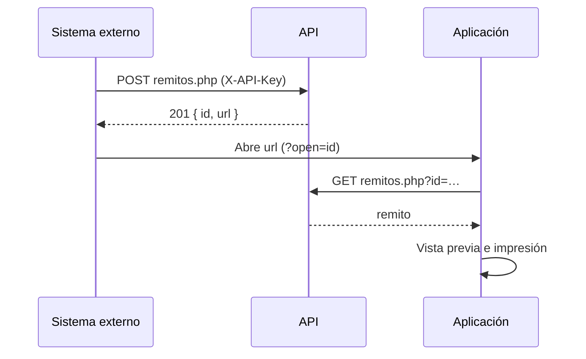

# API de Remitos y Comprobantes

API REST/JSON de la aplicación: usuarios y sesión, clientes, remitos y comprobantes compartidos, ajustes, talonarios de C.A.I., claves de acceso y credenciales de ARCA. La usa la propia aplicación (con la sesión del usuario) y otros sistemas (con una clave de API).

| | |
|---|---|
| **URL base** | `https://intellihelp.tech/remitos/api/` |
| **Formato** | JSON (UTF-8) |
| **Autenticación** | Sesión de usuario (aplicación) o cabecera `X-API-Key` (integraciones) |
| **Errores** | `{ "ok": false, "error": "mensaje" }` con el código HTTP correspondiente |

## Autenticación

### Sesión de usuario (la aplicación)

La aplicación ingresa con correo y contraseña (`sesion.php`) y recibe una cookie de sesión `HttpOnly`, `Secure` y `SameSite=Strict`, más un token CSRF que debe enviar en la cabecera `X-CSRF-Token` en toda escritura. Los permisos dependen del rol:

| Rol | Permisos |
|---|---|
| Operador | `leer`, `crear`, `borrar`: clientes, remitos, comprobantes y autorización de remitos |
| Administrador | Lo anterior más `admin`: usuarios, ajustes, certificados de ARCA, talonarios, claves y auditoría |

La sesión vence tras 8 horas sin actividad o 12 horas desde el ingreso. Cinco contraseñas incorrectas bloquean la cuenta durante 15 minutos.

### Clave de API (integraciones)

Cada petición lleva la clave en la cabecera `X-API-Key`. La clave nunca viaja en la URL.

```
X-API-Key: ith_0123456789abcdef0123456789abcdef
```

| Clave | Dónde se define | Alcance |
|---|---|---|
| **Maestra** | `api/config.php` (se guarda solo su SHA-256) | Todo, igual que un administrador |
| **De servicio** | Panel → Claves | Permisos acotados: `leer`, `crear`, `borrar`. Se guarda solo su SHA-256 y se muestra una única vez |

Una IP que acumula 20 accesos rechazados en 10 minutos queda bloqueada temporalmente (`429`).

## Flujo típico de integración



## Sesión y usuarios

| Método | Operación | Acceso |
|---|---|---|
| `GET sesion.php` | Usuario de la sesión y token CSRF (`usuario: null` sin sesión) | público |
| `POST sesion.php` `{accion: "ingresar", email, clave}` | Inicia sesión | público |
| `POST sesion.php` `{accion: "salir"}` | Cierra la sesión | sesión |
| `POST sesion.php` `{accion: "cambiar_clave", actual, nueva}` | Cambia la contraseña propia (mínimo 10 caracteres, con letras y números) | sesión |
| `GET usuarios.php` | Lista de usuarios | admin |
| `POST usuarios.php` `{nombre, email, rol}` | Alta; devuelve una contraseña temporal una única vez | admin |
| `POST usuarios.php` `{accion: "editar", id, nombre?, rol?, activo?}` | Edición, activación y desbloqueo | admin |
| `POST usuarios.php` `{accion: "restablecer", id}` | Nueva contraseña temporal | admin |
| `DELETE usuarios.php?id={id}` | Baja | admin |

Siempre queda al menos un administrador activo, y nadie puede quitarse el rol, desactivarse ni eliminarse a sí mismo. El primer administrador se crea por línea de comandos: `php api/cli/usuario.php "Nombre Apellido" correo@dominio admin`.

## Clientes

| Método | Operación | Permiso |
|---|---|---|
| `GET clientes.php` | Agenda completa, por razón social | `leer` |
| `POST clientes.php` `{id?, razonSocial, cuit, …}` | Alta o edición; el CUIT se normaliza y no se repite | `crear` |
| `POST clientes.php` `{accion: "importar", clientes: […]}` | Alta o actualización por CUIT, hasta 2000 por vez; los campos vacíos no borran datos | `crear` |
| `DELETE clientes.php?id={id}` | Baja | `borrar` |

## Remitos

### `POST remitos.php` — crear o editar · permiso `crear`

```json
{
  "fecha": "21/10/2026",
  "cliente": {
    "razonSocial": "DISTRIBUIDORA EJEMPLO S.A.",
    "cuit": "30-12345678-9",
    "domicilio": "Av. Corrientes 1234",
    "localidad": "CABA",
    "cp": "C1043",
    "mail": "compras@ejemplo.com.ar"
  },
  "items": [
    { "articulo": "1", "descripcion": "Servicio técnico en sitio", "cantidad": "2 hs" }
  ],
  "recibi": { "tipoDoc": "DNI", "nombre": "María Gómez", "documentoNro": "30.123.456" },
  "transporte": { "nombre": "Transportes Ejemplo", "hora": "14:30", "observaciones": "Entregar en recepción" }
}
```

Respuesta `201`:

```json
{ "ok": true, "id": "9f2c1a77bd0e4a13", "actualizado": false, "url": "https://intellihelp.tech/remitos/?open=9f2c1a77bd0e4a13" }
```

- Todos los campos son opcionales; la fecha (`dd/mm/aaaa`) toma el día actual si falta o es inválida.
- Sin `numero`, el servidor asigna el siguiente correlativo con un bloqueo: dos usuarios nunca obtienen el mismo. Un número repetido se rechaza (`409`).
- Con `id`, edita ese remito. En un remito autorizado, el número, el C.A.I. y su vencimiento no se modifican.
- Los textos se recortan a su longitud máxima y los campos desconocidos se descartan. Se aceptan hasta 60 ítems.
- Si el cuerpo trae `id_local` (identificador del remito en la aplicación) y ya existe, el remito se **actualiza** (`200`, `"actualizado": true`): así funciona el respaldo de la aplicación sin generar duplicados.

| Objeto | Campos |
|---|---|
| `cliente` | `senores`, `razonSocial`, `cuit`, `domicilio`, `localidad`, `telefono`, `cp`, `mail`, `nombre`, `otrosDatos` |
| `items[]` | `articulo`, `descripcion`, `cantidad` |
| `recibi` | `tipoDoc` (`DNI`, `CI`, `Pasaporte`, `Otro`), `nombre`, `documentoNro`, `sector`, `puesto` |
| `transporte` | `nombre`, `vehiculo`, `chofer`, `lugarEntrega`, `fecha`, `hora`, `observaciones` |

### `GET remitos.php?id={id}` — leer · permiso `leer`

El enlace `?open={id}` que devuelve el alta abre el remito en la aplicación, una vez iniciada la sesión.

### `GET remitos.php?pagina=1&por_pagina=50` — listar · permiso `leer`

Remitos completos, del más reciente al más antiguo, con `total`, `pagina` y `paginas`.

### `DELETE remitos.php?id={id}` — eliminar · permiso `borrar`

Un remito autorizado no se elimina (`409`).

## Comprobantes

| Método | Operación | Permiso |
|---|---|---|
| `GET comprobantes.php?pagina=1&por_pagina=50` | Facturas, recibos y notas completos | `leer` |
| `GET comprobantes.php?id={id}` | Un comprobante | `leer` |
| `POST comprobantes.php` `{id?, tipo, subtipo?, letra, ptoVenta, numero?, cliente, items, …}` | Alta o edición. Sin número, el servidor asigna el siguiente de la serie (tipo, letra y punto de venta); la base impide duplicados | `crear` |
| `DELETE comprobantes.php?id={id}` | Baja | `borrar` |

Un comprobante con CAE solo lo modifica o elimina un administrador.

## Ajustes

| Método | Operación | Permiso |
|---|---|---|
| `GET ajustes.php` | `emisor` (ambiente, CUIT, punto de venta, emisión electrónica) y `remito` (punto de venta, ejemplares) | `leer` |
| `POST ajustes.php` `{seccion, valores}` | Actualiza una sección. La emisión electrónica solo se activa con CUIT, punto de venta y un certificado vigente del mismo CUIT | admin |

## Estado

### `GET estado.php` — seguimiento · permiso `leer`

Totales, remitos del día y pendientes de facturar. No incluye importes, ítems, CUIT ni domicilios. Con `?formato=texto` devuelve el mismo resumen en texto plano.

## Talonarios de C.A.I.

| Método | Operación | Permiso |
|---|---|---|
| `GET talonarios.php?accion=listar` | Talonarios con restantes, vencimiento y alertas | admin |
| `GET talonarios.php?accion=vigente&pv=1&tipo=91` | Talonario activo, sin consumir número | `leer` |
| `POST talonarios.php` `{punto_venta, numero_desde, numero_hasta, cai, cai_vencimiento}` | Alta (valida rango, superposición, C.A.I. de 14 dígitos y vigencia) | admin |
| `POST talonarios.php` `{accion: "autorizar", pv, tipo, fecha, remito_id?, confirmar?}` | Asigna el próximo número y el C.A.I. en una transacción con bloqueo de fila; con `remito_id` los escribe en el remito en la misma transacción | `crear` |
| `POST talonarios.php` `{id, activa}` | Activar o desactivar | admin |
| `DELETE talonarios.php?id={id}` | Eliminar (un talonario activo que ya emitió debe desactivarse antes) | admin |

Si el C.A.I. está vencido a la fecha de emisión, `autorizar` responde `409` con `"vencido": true` y solo continúa con `"confirmar": true`.

## ARCA

| Método | Operación | Permiso |
|---|---|---|
| `GET arca.php` | Datos públicos del certificado de cada ambiente (titular, CUIT, vigencia, huella) | `leer` |
| `POST arca.php` `{accion: "cargar", ambiente, cuit?, certificado, clave, frase?, confirmacion?}` | Valida el par y lo guarda cifrado. Solo por HTTPS; con sesión exige reconfirmar la contraseña | admin |
| `POST arca.php` `{accion: "probar", ambiente}` | Verifica los servidores de WSFEv1 y obtiene el ticket de WSAA | `crear` |
| `POST arca.php` `{accion: "quitar", ambiente, confirmacion?}` | Elimina el certificado, la clave y los tickets del ambiente | admin |
| `GET proximo.php?ambiente=&tipo=&subtipo=&letra=&pv=` | Próximo número según ARCA (último autorizado + 1) | `leer` |

`ambiente`: `homologacion` o `produccion`. `tipo`: `factura`, `recibo` o `nota` (`subtipo` `credito` o `debito`). `letra`: `A`, `B` o `C`.

Al cargar un certificado se verifica que sea un PEM X.509 válido y vigente, que la clave privada (RSA de 2048 bits o más) le corresponda y que el CUIT del titular coincida con el informado. Las respuestas nunca incluyen el certificado ni la clave.

## Auditoría y claves

| Método | Operación | Permiso |
|---|---|---|
| `GET claves.php?accion=listar` | Claves de servicio y resumen de uso | admin |
| `GET claves.php?accion=registro&pagina=&por_pagina=&categoria=` | Auditoría paginada | admin |
| `POST claves.php` `{nombre, permisos}` | Crea una clave y la devuelve una única vez | admin |
| `POST claves.php` `{id, activa}` | Activa o desactiva | admin |
| `DELETE claves.php?id={id}` | Elimina | admin |
| `POST evento.php` `{categoria, accion, detalle?, nivel?}` | La aplicación registra sus propios eventos | `crear` |

Categorías de la auditoría: `remito`, `comprobante`, `cliente`, `cai`, `arca`, `clave`, `usuario`, `acceso`, `error`, `sistema`. Se registran los eventos relevantes, no las lecturas de rutina, y se conservan los últimos 2000.

## Ejemplos

**curl**

```bash
curl -X POST https://intellihelp.tech/remitos/api/remitos.php \
  -H "X-API-Key: $REMITOS_API_KEY" \
  -H "Content-Type: application/json" \
  -d '{"cliente":{"razonSocial":"DISTRIBUIDORA EJEMPLO S.A."},"items":[{"articulo":"1","descripcion":"Servicio técnico","cantidad":"2 hs"}]}'
```

**Python**

```python
import os
import requests

API = "https://intellihelp.tech/remitos/api/remitos.php"

def crear_remito(cliente: dict, items: list[dict]) -> str:
    r = requests.post(API, json={"cliente": cliente, "items": items},
                      headers={"X-API-Key": os.environ["REMITOS_API_KEY"]}, timeout=15)
    r.raise_for_status()
    return r.json()["url"]
```

**JavaScript**

```javascript
const res = await fetch('https://intellihelp.tech/remitos/api/remitos.php', {
  method: 'POST',
  headers: { 'X-API-Key': process.env.REMITOS_API_KEY, 'Content-Type': 'application/json' },
  body: JSON.stringify({ cliente: { razonSocial: 'DISTRIBUIDORA EJEMPLO S.A.' }, items: [] }),
});
const { url } = await res.json();
```

## Códigos de respuesta

| Código | Significado |
|---|---|
| `200` / `201` | Operación correcta / recurso creado |
| `400` | Datos inválidos |
| `401` | Falta la clave o es inválida |
| `403` | Sin el permiso necesario, clave desactivada, token CSRF ausente, contraseña temporal sin cambiar u operación que exige HTTPS |
| `404` | Recurso inexistente |
| `409` | Conflicto (número repetido, talonario agotado o vencido, rango superpuesto, remito ya autorizado, sin certificado) |
| `413` | Cuerpo demasiado grande |
| `422` | Certificado o clave privada rechazados |
| `429` | Demasiados intentos rechazados (clave o ingreso) desde la misma IP |
| `502` | ARCA rechazó la operación o no respondió |
